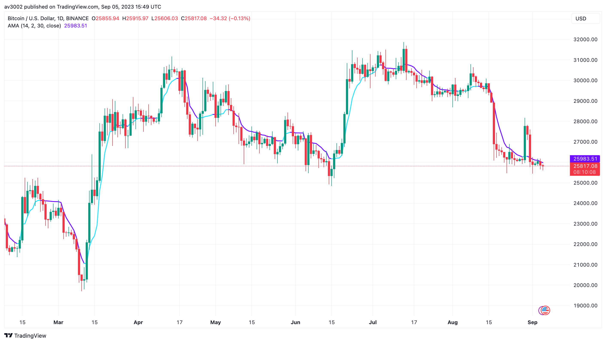
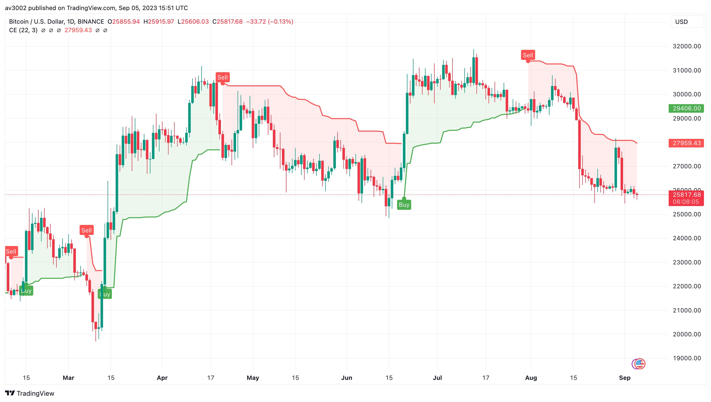
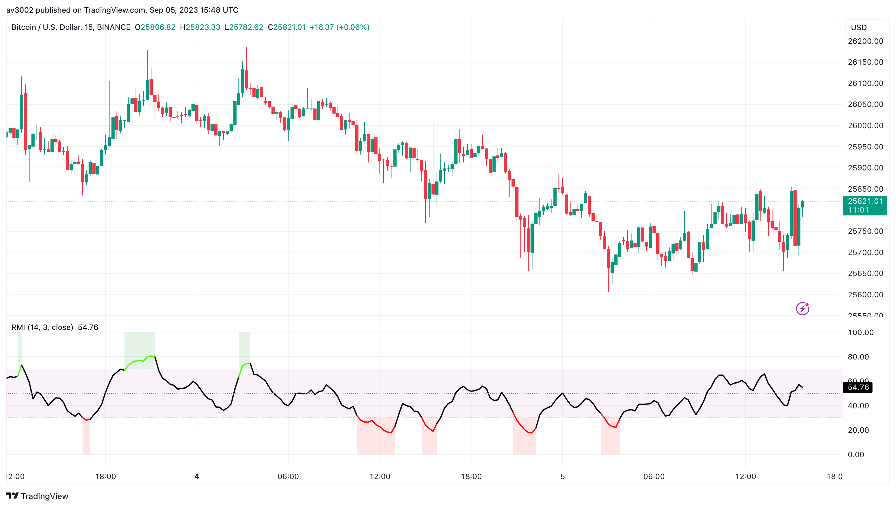
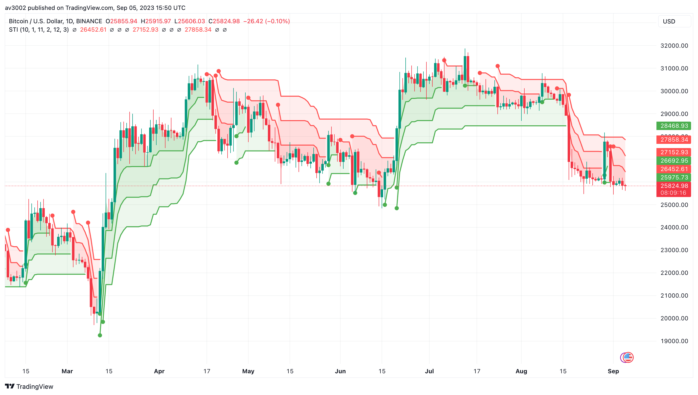
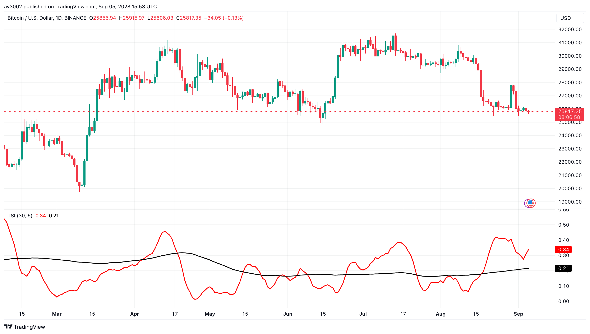

# Pine Strategy Indicators v5

Five open-source TradingView indicators written in Pine Script v6: Adaptive Moving Average, Chandelier Exit, Relative Momentum Index, Supertrend and Trend Strength Index. Part of [GAINZ](https://gainz-trading-indicators.vercel.app), 35 indicators across seven collections.

| Indicator                                           | Type       | Script                                                                    |
| --------------------------------------------------- | ---------- | ------------------------------------------------------------------------- |
| [Adaptive Moving Average](#adaptive-moving-average) | Trend      | [`adaptive-moving-average.pine`](indicators/adaptive-moving-average.pine) |
| [Chandelier Exit](#chandelier-exit)                 | Volatility | [`chandelier-exit.pine`](indicators/chandelier-exit.pine)                 |
| [Relative Momentum Index](#relative-momentum-index) | Momentum   | [`relative-momentum-index.pine`](indicators/relative-momentum-index.pine) |
| [Supertrend](#supertrend)                           | Trend      | [`supertrend.pine`](indicators/supertrend.pine)                           |
| [Trend Strength Index](#trend-strength-index)       | Momentum   | [`trend-strength-index.pine`](indicators/trend-strength-index.pine)       |

## Adaptive Moving Average

A moving average that speeds up in trends and slows down in chop, blending a fast and a slow EMA.

A rising, highlighted line means the trend is in charge. When it flattens out, the market is losing direction.

| Setting  | Default |
| -------- | ------- |
| Length   | 14      |
| Fast EMA | 2       |
| Slow EMA | 30      |
| Source   | Close   |

Based on Adaptive Moving Average by everget.

## Chandelier Exit

A trailing stop hung from the highest high, or the lowest low, by three times the ATR.

Buy and Sell labels mark the bar where price crosses the stop and the trend flips. An alert fires on every change of direction.

| Setting        | Default    |
| -------------- | ---------- |
| ATR period     | 22         |
| ATR multiplier | 3.0        |
| Labels         | Buy / Sell |

Based on Chandelier Exit by everget.

## Relative Momentum Index

RSI's cousin: it compares each close with the close a few bars back instead of the one just before it.

Smoother than RSI and quicker to show a trend. Breakouts above overbought or below oversold are highlighted for you.

| Setting  | Default |
| -------- | ------- |
| Length   | 14      |
| Momentum | 3       |
| Source   | Close   |

Based on Relative Momentum Index by everget.

## Supertrend

Three ATR-based trend lines at different distances from price, from tight to loose.

Green under price means up, red above means down. When all three agree the trend is strong; the tight line flips first.

| Setting | Default    |
| ------- | ---------- |
| Line 1  | ATR 10 × 1 |
| Line 2  | ATR 11 × 2 |
| Line 3  | ATR 12 × 3 |

## Trend Strength Index

Measures how close to a straight line price has moved over the last 30 bars, from 0 to 1.

Near 1, price has moved in a clean line; near 0, it has chopped back and forth with no trend worth following. It shows strength, not direction.

| Setting   | Default |
| --------- | ------- |
| Length    | 30      |
| Smoothing | 5       |

Based on Trend Strength Index by Tradingene.

## How to use

1. Open the indicator's `.pine` file in `indicators/` and copy the code.
2. In TradingView, open the Pine Editor, paste the code and save it.
3. Click **Add to chart**, then change the defaults in the indicator's settings.

## Disclaimer

For learning and research. Indicators describe what price has done, not what it will do. Nothing here is financial advice.

## License

[MIT](LICENSE). Indicators based on someone else's work keep their original author's terms.
